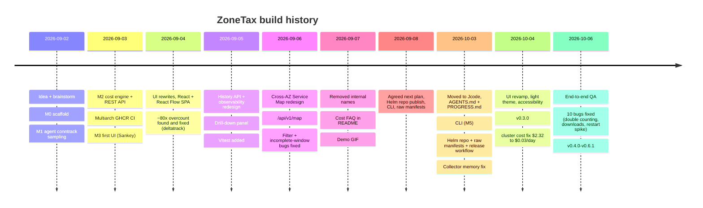

# Progress log

Chronological record of how ZoneTax was built and why. Append new entries at the bottom.
For the quick brief, see [AGENTS.md](../AGENTS.md). For milestone detail, see [ROADMAP.md](../ROADMAP.md).

## Timeline

## Key decisions

| Decision | Why |
|---|---|
| conntrack, not eBPF | Measures within 1% of bytes sent; residual is header overhead AWS bills too. eBPF adds kernel/privilege burden for no accuracy gain |
| Node labels for AZ, not IMDS | No extra IAM, no cloud-specific code |
| Agent emits raw bytes only, collector prices | Keep agent dumb and fast, one place for pricing |
| Cross-AZ priced both directions ($0.02/GB effective) | Matches how AWS bills; single-direction was a 2x undercount |
| React + @xyflow/react instead of hand-rolled D3/SVG | Five SVG iterations failed on drag/zoom. Delegate to a graph library |
| Persistent drill-down panel, not tooltips | Tooltips cap at top-5 and cannot be clicked into |
| Snapshot diffing for history | Collector totals are cumulative counters |
| Honest `has_data` / `complete` flags | Never fabricate or extrapolate missing windows |
| ZoneTax counts its own scrape traffic | A cost tool should not hide its own footprint (~$0.0002/day measured) |
| Raw manifests generated from Helm (planned) | Avoid two hand-maintained copies drifting |

## Accuracy vs AWS billing

- Pre-fix: ~$173/day extrapolated vs ~$2.13/day AWS (`DataTransfer-Regional-Bytes`), ~80x.
- Root cause: conntrack `bytes=` is cumulative per connection lifetime, was re-added every tick.
- Post-fix: ~$8.35/day on a 10-min sample, ~4x. Residual explained by AWS figure being
  account-wide and short-sample extrapolation. A proper 24h comparison was requested on
  2026-09-07; the README FAQ cites ~$1.94/day real spend over a 28h session.

## Known open items

- Alerting (M4) not started.
- DaemonSet rollouts can stall on memory-pressured nodes (delete pods manually).

## Session log

### 2026-10-03 (Jcode)
Previous Hermes session (2026-09-02 to 2026-09-24, ~3500 messages) exhausted its context. Recovered
state from the Hermes session DB, wrote `AGENTS.md` (auto-loaded brief) and this file so future
sessions start with full context. Next: Helm repo publish, then CLI, then generated manifests.

### 2026-10-03 (Jcode, part 2): CLI, Helm, release
- `cmd/zonetax` CLI (`top`, `report`, `version`), tests against a fake collector.
- Found live: collector up 25 days at its 256Mi limit, all agent scrapes timing out, `/costs`
  taking ~60s. Cause: history kept every 30s snapshot for 7 days (~20k, each with a route map).
  Fix: snapshots older than 1h downsampled to 5-min slots (~2k for 7d), plus GOMEMLIMIT.
- `release.yml` on tag publishes CLI binaries, chart, install.yaml, and the gh-pages Helm index.
- `hack/gen-manifests.sh` generates `deploy/manifests/install.yaml`, CI drift check.
- Chart: image tag defaults to appVersion (was `latest`), explicit namespaces.
- Released **v0.1.0**: GitHub Release (4 CLI binaries, chart, install.yaml, checksums), images
  tagged 0.1.0, Helm repo on GitHub Pages. Verified as a new user: `helm repo add` + `search` +
  `template` (pinned 0.1.0 images), install.yaml kubectl dry-run, downloaded CLI binary runs.

### 2026-10-03 (part 3): persistent history, v0.2.0
- History saved to `/data/history.json.gz` every 5 min + on shutdown, reloaded on start.
  7 days x 40 routes measured at ~0.7 MB. emptyDir default, `collector.persistence.enabled` PVC.
- Downtime is a gap marker: fully-down hours = no data, partly-down = partial, never back-filled.
- Found while designing it: history diffed raw merged agent totals, so one failed agent scrape
  made the next cycle look like a counter reset (fake spike). Now per-agent observed deltas.
- Found deploying it: switching an existing Deployment to `type: Recreate` is rejected by the
  API server; used RollingUpdate maxSurge 0 instead. `--reuse-values` dropped the new `size`
  default (PVC rendered "0"); template now defaults to 1Gi.
- Live test on dev: deleted the collector pod, new pod logged "restored history", history start
  unchanged, totals continued (371 MB -> 405 MB), 15m window across restart = incomplete.
- Follow-up live checks: a window ending between the last periodic save and the pod kill had
  routes (so the shutdown save ran); a window inside history spanning the restart is
  complete=false, while windows entirely before or after it are complete=true.

### 2026-10-04: accuracy check + UI revamp, v0.3.0
- Accuracy: ZoneTax $2.017/day vs AWS $2.094/day for this cluster's EC2 instances (-3.7%),
  using Cost Explorer per-resource data (`docs/accuracy.md`). Earlier "4x" came from comparing a
  10-minute sample against the account-wide total.
- UI audit before: axe passed, but legend colours did not match the map, red/green scale not
  colour-blind safe, partial windows painted every edge amber (cost hidden), spend chart hidden,
  table rows / map not keyboard reachable, no visible focus, sub-cent noise ($0.004897).
- After: single magma-style cost scale (contrast-tested), dark + light themes, KPI cards with
  projected per day/month, promoted spend chart, layered workload map, simpler filters, full
  keyboard support. axe 0 violations dark + light on the deployed build; colour-blindness
  simulation checked; no horizontal overflow at 390 px.

### 2026-10-06: end-to-end QA, v0.4.0 to v0.6.1
Full QA against the live cluster (plan: docs/qa/qa-plan.md, results: docs/qa/report-2026-10-06.md).
Ten bugs found and fixed, including three that made the numbers wrong:
- every cross-node connection counted twice (1 GiB read as 2.16 GB),
- downloads not counted at all (1 GiB read as 0.003 GB),
- agent restarts reporting ~4 GB of fake traffic from pre-existing connections.
These first two partly cancelled out, which is why the earlier "within 4% of the AWS bill" looked
good; that claim is corrected in docs/accuracy.md. After the fixes, controlled tests measure
within 1%. Also: traffic via Services and node IPs is now attributed, unattributed traffic is
reported instead of silently dropped, partial windows say how much time was missed, the agent
DaemonSet rollout no longer stalls, and the sticky header no longer overlaps the page.

## 2026-10-15 — Region auto-detection, coverage reporting, data validation

Reported symptom: a `us-west-2` install displayed `us-east-1`.

Root cause: `cmd/collector/main.go` defaulted `Region` to a hard-coded `"us-east-1"`, and
`CLOUD_REGION` was **never referenced in the Helm chart** — so no Helm install ever set it and
every deployment reported `us-east-1` regardless of location. Verified on the live collector,
whose only env vars were `GOMEMLIMIT` and `HISTORY_FILE`.

Dollar amounts were unaffected today (every AWS region in the table is $0.01/GB), but the region
lookup and the displayed region were wrong, and it would have become a real mispricing bug as
soon as a differently-priced region was added.

Fixes:
- `internal/clouddetect`: infer cloud + region from `spec.providerID` and
  `topology.kubernetes.io/{region,zone}`, with majority voting across nodes. RBAC already
  allowed node reads. Priority: env override > detection > cloud default with an **empty**
  region (never a fabricated one).
- `cloud.provider` / `cloud.region` exposed in `values.yaml`, empty = auto-detect. Default
  manifests unchanged.
- `costengine.Coverage` + `coverage` in `/api/v1/costs`: an agent had been Pending 4d5h, leaving
  1 of 5 nodes unmeasured with no way to tell that from "no traffic". Now reported explicitly
  and logged as `PARTIAL COVERAGE`.
- Fixed `TestStore_RestartKeepsHistoryAndMarksDowntime` and `TestStore_DowntimeMidHourIsPartial`,
  which were already failing on `main`: they anchored to a fixed 2026-10-01 date that had aged
  out of the 7-day retention window. Now relative to now via `recentBase()`.

Validation (live, 8 days of data): totals arithmetic exact ($0.27596 = 13.798 GB x $0.02),
169/169 history buckets populated, retention bound honoured, 2 edge buckets correctly flagged
incomplete, 7-day spend $0.2224 (~$0.032/day). The 2026-10-04 co-location fix has held 11 days.
`go test -race ./...` green, 82 UI tests pass, no manifest drift. Details in
`docs/qa/report-2026-10-15.md`.

Decision recorded: Azure will not be supported — Microsoft removed cross-AZ transfer charges in
May 2024, so there is no cost to report. GCP is viable but needs the billing model made
per-cloud first (sender-side only, billed per GiB, vs AWS both-directions per GB).

## 2026-10-15 (later) — Scope closed: AWS-only, conntrack, no alerting

Three things removed from the roadmap rather than built, each recorded as a reasoned non-goal in
`ROADMAP.md` so the decision survives rather than getting silently re-added.

**eBPF — dropped.** It was listed as a "possible v2" from the MVP days, but the premise no longer
holds. eBPF's selling point is accuracy, and conntrack sampling already measures within 1% of
bytes actually sent. The residual ~0.7% is TCP/IP header overhead, which is what AWS bills
anyway, so eBPF would observe the same wire bytes and produce the same number. Against zero
accuracy gain it would add kernel-version constraints, `CAP_BPF` and clang/libbpf tooling to an
agent that already needs `hostNetwork` (the main adoption barrier), and would mean rewriting the
one component whose correctness was hardest to earn — every serious counting bug found so far
lives in that path. What actually limits agreement with the AWS bill is attribution scope
(pod-to-pod), which eBPF wouldn't change.

**Other clouds and built-in alerting** were already settled earlier today; this pass made the
wording consistent everywhere.

Also cleaned up stale framing that no longer matched reality:
- `docs/architecture.md`: "Why conntrack over eBPF for MVP" rewritten as "Why conntrack, not
  eBPF", citing the measured results instead of "good enough".
- `ROADMAP.md`: M1 no longer claims accuracy validation is "still pending" (it was done weeks
  ago); M2's dangling "see Known limitations" pointer removed; "Non-goals (for now)" is now just
  "Non-goals"; the resolved conntrack-sysctl/distroless findings moved out of Known Limitations
  since they are fixed and shipped in the chart.
- Known limitations now reflect today's work: the unmeasured-node entry points at
  `agent.priorityClassName` and notes that coverage is reported via the API and
  `zonetax_coverage_complete`, and pod-to-pod attribution is stated as an explicit limitation.
- `README.md`: dropped "Early stage, AWS/EKS only for now" and "AWS first" in favour of stating
  the narrow scope deliberately.

Verified: all internal doc links and heading anchors resolve, 14 packages pass `go test -race`,
no manifest drift. Roadmap is now down to M6 (blog writeup).

## 2026-10-15 (later) — Measurement gap closed on the test cluster

Set `agent.priorityClassName=system-node-critical`. The agent that had been Pending for 8 days
on a memory-full node now runs, taking coverage from 4/5 to **5/5 nodes** and
`coverage.complete` from false to true. The `ZoneTaxCoverageIncomplete` alert added earlier the
same day went from firing to resolved.

Checked the premise before deploying: the node was at 98% memory requests but carried four
priority-0 pods, so a high-priority agent had something to preempt. The earlier "No preemption
victims found" event was a consequence of the agent having no priority itself, not of the node
being genuinely unpreemptable.

Confirmed the new agent measures rather than merely runs: its `/metrics` reports cross-AZ byte
counters for real flows on that node which had been invisible for 8 days. Counters climbed
smoothly from the priming baseline with no restart spike across a full DaemonSet replacement,
and persisted history survived (169 buckets, `history_start` unchanged).

Recorded in the dev values file rather than as a `--set` flag, so the cluster is reproducible
from the file (verified with `helm get values`).
